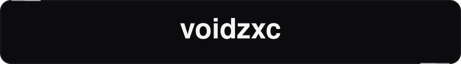
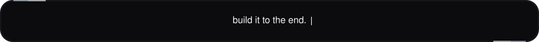

  <picture>
    <source media="(max-width: 759px)" srcset="hero-sm.svg">
    
  </picture>

  
  &nbsp;&nbsp;
  
  &nbsp;&nbsp;
  
  &nbsp;&nbsp;
  
  &nbsp;&nbsp;
  

  <picture>
    <source media="(max-width: 759px)" srcset="tools-sm.svg">
    
  </picture>

  <picture>
    <source media="(max-width: 759px)" srcset="work-sm.svg">
    
  </picture>

## Now

**[cursor-presence](https://github.com/voidzxcdev/cursor-presence)** 
Discord Rich Presence for Cursor that follows the agent.

**[voidzxc.cv](https://voidzxc.cv)** 
Site and CV.

  <picture>
    <source media="(max-width: 759px)" srcset="close-sm.svg">
    
  </picture>

